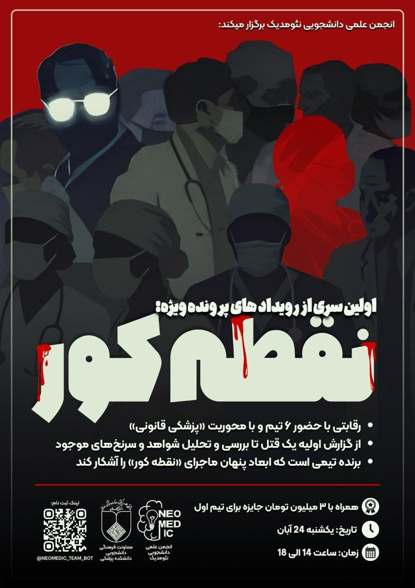

# 🩸 رویداد پرونده ویژه «نقطه کور» | سامانه رمزگشایی شواهد

<div align="center">
  
  
  <br/><br/>

  [](https://github.com/RealM0khii/noghte-koor-NeoMedic)
  [](https://github.com/RealM0khii/noghte-koor-NeoMedic)
  [](https://github.com/RealM0khii)
  [](https://github.com/RealM0khii/noghte-koor-NeoMedic)
  [](https://github.com/RealM0khii/noghte-koor-NeoMedic)

  <p align="center">
    <b>صفحه وب تعاملی و ترمینال رمزگشایی پرونده جنایی برای مسابقه دانشجویی پزشکی قانونی</b><br/>
    <i>طراحی شده با الهام از اتمسفر دارک/نوآر پوستر رسمی رویداد</i>
  </p>
</div>

---

## 📌 درباره رویداد

«**نقطه کور**» اولین سری از رویدادهای پرونده ویژه است که توسط **انجمن خلاقیت و کارآفرینی نئومدیک (NEOMEDIC)** در دانشکده پزشکی دانشگاه علوم پزشکی اصفهان با محوریت پزشکی قانونی برگزار می‌شود. در این مسابقه، ۶ تیم از دانشجویان با بررسی گزارش اولیه یک پرونده قتل و تحلیل سرنخ‌ها و شواهد آزمایشگاهی به رقابت می‌پردازند تا ابعاد پنهان ماجرا را آشکار سازند.

این پروژه، وب‌اپلیکیشن اختصاصی مرحله نهایی / مرحله رمزگشایی پرونده است که شرکت‌کنندگان برای گشودن قفل شواهد و دسترسی به اطلاعات محرمانه بعدی باید رمز آن را کشف و وارد نمایند.

---

## ✨ ویژگی‌های فنی و طراحی

- **هماهنگی بصری ۱۰۰٪ با پوستر رویداد:**
  - تم اختصاصی Crimson Noir با نورپردازی تیره و گرادیان سرخ ملایم صحنه جرم.
  - تایپوگرافی ویژه عنوان با فونت اختصاصی **بهمن (`ig6_bahman.ttf`)** همراه با افکت قطرات چکیدهٔ خون.
  - تعبیهٔ لوگوی رسمی انجمن نئومدیک (`logo.jpg`) در سربرگ سامانه.
  - پنجره پاپ‌آپ (Modal) برای مشاهدهٔ پوستر اصلی رویداد (`poster.jpg`).

- **سیستم ورودی ۶ بخشی و تجربه کاربری (UX) بهینه‌سازی‌شده:**
  - امکان ورود تا ۲ کاراکتر در تمام ۶ بخش (`maxlength="2"`).
  - عدم پرش ناخواسته: در صورتی که کاربر یک کاراکتر وارد کند، صفحه پرش نمی‌کند و امکان تکمیل یا جابه‌جایی با کلیک و کلیدهای جهت‌نما فراهم است.
  - قابلیت هوشمند **Capitalize**: حرف اول هر بخش به‌صورت خودکار بزرگ (Capital) و حرف دوم کوچک نمایش داده می‌شود (IUPAC Standard Display).
  - عدم حساسیت به بزرگی و کوچکی حروف در اعتبارسنجی (Case-Insensitive).
  - پشتیبانی کامل از کیبورد (Enter، Tab، Backspace) و قابلیت پیست یک‌باره کل کد رمز (با خط تیره، فاصله یا پیوسته).

- **امنیت معما و جلوگیری از تقلب (Anti-Cheat):**
  - **حفاظت با هش رمزنگاری SHA-256:** رمز و نام عناصر به صورت متن خام در کدهای صفحه وجود ندارد و تطبیق از طریق مقایسه هش درهم‌ساز صورت می‌پذیرد؛ بنابراین با فشردن کلید `F12` (Inspect Element) یا مشاهده سورس‌کد، معما لو نخواهد رفت.
  - حذف کلیه داده‌ها و صفات راهنما از ساختار HTML.
  - پیام خطای عمومی بدون اشاره به نحوه کشف رمز در هنگام ورود اشتباه.

- **افکت‌های صوتی و بصری بدون وابستگی خارجی:**
  - استفاده از **Web Audio API** برای تولید صداهای سینمایی کلید، هشدار خطا و آکورد پیروزی (کاملاً آفلاین و بدون نیاز به دانلود فایل صوتی).
  - انیمیشن پارتیکل و آتش‌بازی نوری روی بوم Canvas پس از بازگشایی موفق.
  - مهر چرخان قرمز «فوق‌محرمانه» و پیام رمزگشایی نهایی.

---

## 🔒 معمای پشت پرده (اسپویلر)

<details>
<summary><b>🔍 مشاهده راه‌حل معما و منطق رمزگشایی (کلیک کنید)</b></summary>

<br/>

شرکت‌کنندگان بر اساس شواهد و شماره‌های ارائه شده در پرونده با ۶ شماره روبرو می‌شوند:
```
4  -  20  -  75  -  9  -  92  -  3
```

این شماره‌ها متناظر با **شماره اتمی عناصر در جدول تناوبی مندلیف** هستند:
| شماره اتمی | نام عنصر | نماد شیمیایی |
|:---:|:---:|:---:|
| **۴** | Beryllium | `Be` |
| **۲۰** | Calcium | `Ca` |
| **۷۵** | Rhenium | `Re` |
| **۹** | Fluorine | `F` |
| **۹۲** | Uranium | `U` |
| **۳** | Lithium | `Li` |

با چیدن نمادها در کنار یکدیگر عبارت هشداردهندهٔ زیر به دست می‌آید:
$$\mathbf{Be} + \mathbf{Ca} + \mathbf{Re} + \mathbf{F} + \mathbf{U} + \mathbf{Li} \longrightarrow \mathbf{BeCaReFULi} \quad (\text{Be Careful!})$$

پس از وارد کردن این ترکیب، پیام بازگشایی پرونده به شرکت‌کنندگان اعلام می‌گردد:
> **«بدون سر و صدا از برگزارکننده ایمیل محرمانه رو دریافت کن !!!»**

</details>

---

## 📂 ساختار فایل‌ها

```text
├── index.html        # فایل اصلی برنامه (شامل HTML, CSS و JavaScript به صورت یکپارچه)
├── ig6_bahman.ttf    # فونت اختصاصی «بهمن» جهت رندر عنوان اصلی
├── logo.jpg          # لوگوی رسمی انجمن دانشجویی نئومدیک
├── poster.jpg        # پوستر باکیفیت رویداد نقطه کور
├── README.md         # مستندات کامل پروژه
└── .gitignore        # نادیده گرفتن فایل‌های حاوی رمز یا فایل‌های سیستمی
```

---

## 🚀 نحوه اجرا

این پروژه با **Pure Vanilla Web Technologies** (HTML5, CSS3, ES6 JavaScript) توسعه داده شده و به هیچ پکیج، بیلد، یا سرور خاصی وابستگی ندارد.

1. ریپازیتوری را دانلود یا کلون کنید:
   ```bash
   git clone https://github.com/RealM0khii/noghte-koor-NeoMedic.git
   ```
2. فایل `index.html` را در هر مرورگری (Chrome، Edge، Firefox، Safari) باز کنید.
3. تمام امکانات (شامل صدا، فونت، پوستر و انیمیشن‌ها) به شکل **کاملاً آفلاین** کار خواهند کرد.

---

## 👥 شناسنامه رویداد و عوامل اجرایی

- **رویداد:** اولین سری از رویدادهای پرونده ویژه: «نقطه کور»
- **برگزارکننده:** انجمن خلاقیت و کارآفرینی نئومدیک (NEOMEDIC)
- **دانشکده و دانشگاه:** دانشکده پزشکی دانشگاه علوم پزشکی اصفهان (با همکاری معاونت فرهنگی دانشجویی دانشکده پزشکی)
- **تاریخ و زمان برگزاری:** یکشنبه ۲۴ آبان ماه • ساعت ۱۴:۰۰ الی ۱۸:۰۰
- **طراح و توسعه‌دهنده وب‌اپلیکیشن (صفحه HTML):** [علی مختاری](https://github.com/RealM0khii) (Ali Mokhtari)
